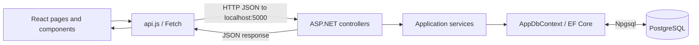
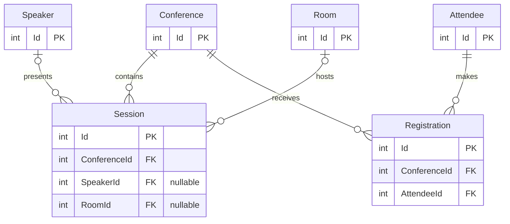

# BrownEvents architecture

## 1. Purpose, scope and evidence

BEVN-001 maps the existing application for a new team member. Scope and acceptance criteria come from [issue #2](https://github.com/maiano/brown-events-pilot/issues/2), read through GitHub MCP, including its Pilot addition requiring frontend coverage and an explainable feature walkthrough. Repository workflow and documentation responsibilities are defined in [AGENTS.md:1](../AGENTS.md#L1).

The map describes source revision `4cdcbb2` based on static analysis. All three controller files and all eight service files, including interfaces, were inspected. The controller entry points are [ConferencesController.cs:7](../backend/BrownEvents.Api/Controllers/ConferencesController.cs#L7), [SessionsController.cs:7](../backend/BrownEvents.Api/Controllers/SessionsController.cs#L7), and [SpeakersController.cs:7](../backend/BrownEvents.Api/Controllers/SpeakersController.cs#L7). Service contracts are [IConferenceService.cs:5](../backend/BrownEvents.Api/Services/IConferenceService.cs#L5), [ISessionService.cs:5](../backend/BrownEvents.Api/Services/ISessionService.cs#L5), [ISpeakerService.cs:5](../backend/BrownEvents.Api/Services/ISpeakerService.cs#L5), and [IRegistrationService.cs:5](../backend/BrownEvents.Api/Services/IRegistrationService.cs#L5); implementations are cited below. No application, build or tests were run for this map.

Source links are relative to this document and carry GitHub line anchors. Negative findings describe the inspected repository, not external hosting or an existing database.

## 2. System overview

BrownEvents lets users browse conferences, inspect sessions and register for a conference. React routes expose those screens; a shared Fetch client sends JSON requests to an ASP.NET Core API, whose services use EF Core and PostgreSQL. Evidence: [App.jsx:11](../frontend/src/App.jsx#L11), [api.js:3](../frontend/src/api.js#L3), [ConferencesController.cs:19](../backend/BrownEvents.Api/Controllers/ConferencesController.cs#L19), [ConferenceService.cs:16](../backend/BrownEvents.Api/Services/ConferenceService.cs#L16), and [Program.cs:11](../backend/BrownEvents.Api/Program.cs#L11).

Diagram evidence: [main.jsx:6](../frontend/src/main.jsx#L6), [api.js:1](../frontend/src/api.js#L1), [ConferencesController.cs:19](../backend/BrownEvents.Api/Controllers/ConferencesController.cs#L19), [ConferenceService.cs:9](../backend/BrownEvents.Api/Services/ConferenceService.cs#L9), [Program.cs:14](../backend/BrownEvents.Api/Program.cs#L14). Compose defines PostgreSQL 14, backend and frontend services at [docker-compose.yml:5](../docker-compose.yml#L5), [docker-compose.yml:21](../docker-compose.yml#L21), and [docker-compose.yml:34](../docker-compose.yml#L34).

## 3. Repository and layer responsibilities

| Location/layer | Responsibility | Source evidence |
| --- | --- | --- |
| `backend/BrownEvents.Api/Program.cs` | Configure dependencies, JSON, CORS, Swagger, controller routing and database startup. | [Program.cs:8](../backend/BrownEvents.Api/Program.cs#L8), lines 8–62 |
| `backend/BrownEvents.Api/Controllers/` | Translate routes and request bodies into service calls and HTTP results. Conference, session and speaker endpoints live here. | [ConferencesController.cs:7](../backend/BrownEvents.Api/Controllers/ConferencesController.cs#L7), [SessionsController.cs:7](../backend/BrownEvents.Api/Controllers/SessionsController.cs#L7), [SpeakersController.cs:7](../backend/BrownEvents.Api/Controllers/SpeakersController.cs#L7) |
| `backend/BrownEvents.Api/Services/` | Query and change entities directly through the context; handle attendee reuse and registration creation. No intermediate repository layer appears in these implementations. | [ConferenceService.cs:9](../backend/BrownEvents.Api/Services/ConferenceService.cs#L9), [SessionService.cs:9](../backend/BrownEvents.Api/Services/SessionService.cs#L9), [SpeakerService.cs:9](../backend/BrownEvents.Api/Services/SpeakerService.cs#L9), [RegistrationService.cs:8](../backend/BrownEvents.Api/Services/RegistrationService.cs#L8) |
| `backend/BrownEvents.Api/Models/` | Define persisted fields and navigation properties; controllers also use these entity types as request/response models. | [Conference.cs:3](../backend/BrownEvents.Api/Models/Conference.cs#L3), [ConferencesController.cs:34](../backend/BrownEvents.Api/Controllers/ConferencesController.cs#L34), [ConferencesController.cs:70](../backend/BrownEvents.Api/Controllers/ConferencesController.cs#L70) |
| `backend/BrownEvents.Api/Data/` | Expose entity sets, configure tables/relationships and seed demo data. | [AppDbContext.cs:10](../backend/BrownEvents.Api/Data/AppDbContext.cs#L10), [DataSeeder.cs:5](../backend/BrownEvents.Api/Data/DataSeeder.cs#L5) |
| `backend/BrownEvents.Tests/` | Exercise conference and session services with EF Core InMemory. | [ConferenceServiceTests.cs:11](../backend/BrownEvents.Tests/ConferenceServiceTests.cs#L11), [SessionServiceTests.cs:11](../backend/BrownEvents.Tests/SessionServiceTests.cs#L11) |
| `frontend/src/` | Mount the React application, route screens, manage page state, render components and call the API. | [main.jsx:6](../frontend/src/main.jsx#L6), [App.jsx:9](../frontend/src/App.jsx#L9), [ConferenceDetailPage.jsx:10](../frontend/src/pages/ConferenceDetailPage.jsx#L10), [api.js:3](../frontend/src/api.js#L3) |
| Frontend hosting configuration | Vite development server and Nginx SPA/API routing. | [vite.config.js:6](../frontend/vite.config.js#L6), [nginx.conf:1](../frontend/nginx.conf#L1) |

## 4. Frontend architecture

The application uses React 18, React Router 6 and Vite 4; `main.jsx` mounts `App` inside `React.StrictMode`. Evidence: [package.json:11](../frontend/package.json#L11), [main.jsx:6](../frontend/src/main.jsx#L6).

| Route | Page and responsibility | Evidence |
| --- | --- | --- |
| `/` | Load the conference array and render cards; track loading/error state. | [App.jsx:11](../frontend/src/App.jsx#L11), [ConferenceListPage.jsx:6](../frontend/src/pages/ConferenceListPage.jsx#L6), [ConferenceCard.jsx:20](../frontend/src/components/ConferenceCard.jsx#L20) |
| `/conferences/:id` | Load conference, sessions and registrations through three effects; own selection and registration-modal state. | [App.jsx:12](../frontend/src/App.jsx#L12), [ConferenceDetailPage.jsx:10](../frontend/src/pages/ConferenceDetailPage.jsx#L10), effects at lines 37, 54 and 68 |
| `/conferences/:id/sessions/:sessionId` | Fetch session detail; use the conference ID for navigation and the session ID for the API lookup. | [App.jsx:13](../frontend/src/App.jsx#L13), [SessionDetailPage.jsx:6](../frontend/src/pages/SessionDetailPage.jsx#L6) |
| `/conferences/:id/register` | Submit the standalone conference registration form and display success/error state. | [App.jsx:14](../frontend/src/App.jsx#L14), [RegistrationPage.jsx:9](../frontend/src/pages/RegistrationPage.jsx#L9), [RegistrationPage.jsx:25](../frontend/src/pages/RegistrationPage.jsx#L25) |

Session selection passes through props from the detail page to `SessionList` and `SessionCard`; clicking a card invokes the callback, while its detail link navigates separately. Evidence: [ConferenceDetailPage.jsx:82](../frontend/src/pages/ConferenceDetailPage.jsx#L82), [ConferenceDetailPage.jsx:238](../frontend/src/pages/ConferenceDetailPage.jsx#L238), [SessionList.jsx:4](../frontend/src/components/SessionList.jsx#L4), [SessionCard.jsx:11](../frontend/src/components/SessionCard.jsx#L11), [SessionCard.jsx:21](../frontend/src/components/SessionCard.jsx#L21).

The shared HTTP wrapper parses successful responses as JSON and throws response text or an HTTP-status message on failure. The sessions helper unwraps the backend's `data` envelope. Evidence: [api.js:3](../frontend/src/api.js#L3), [api.js:26](../frontend/src/api.js#L26).

## 5. Backend architecture

The API targets .NET 6 and references EF Core 6, Npgsql, EF lazy-loading proxies and Swashbuckle. `Program.cs` registers four scoped service implementations and a singleton context configured with PostgreSQL and lazy loading. Evidence: [BrownEvents.Api.csproj:4](../backend/BrownEvents.Api/BrownEvents.Api.csproj#L4), [BrownEvents.Api.csproj:11](../backend/BrownEvents.Api/BrownEvents.Api.csproj#L11), [Program.cs:11](../backend/BrownEvents.Api/Program.cs#L11), [Program.cs:20](../backend/BrownEvents.Api/Program.cs#L20).

Controllers return entities directly. Conference and session detail/update actions return 404 when services return null; successful actions use `Ok`. Conference-session list/create actions wrap results in `{ data: ... }`. Evidence: [ConferencesController.cs:19](../backend/BrownEvents.Api/Controllers/ConferencesController.cs#L19), [ConferencesController.cs:41](../backend/BrownEvents.Api/Controllers/ConferencesController.cs#L41), [ConferencesController.cs:49](../backend/BrownEvents.Api/Controllers/ConferencesController.cs#L49), [SessionsController.cs:17](../backend/BrownEvents.Api/Controllers/SessionsController.cs#L17).

Serialization uses `ReferenceHandler.IgnoreCycles`. With lazy-loading proxies and virtual navigation properties, serializing related entities can cause additional loads; exact query counts and response graphs have not been measured. Evidence: [Program.cs:15](../backend/BrownEvents.Api/Program.cs#L15), [Program.cs:25](../backend/BrownEvents.Api/Program.cs#L25), [Conference.cs:17](../backend/BrownEvents.Api/Models/Conference.cs#L17), [Session.cs:16](../backend/BrownEvents.Api/Models/Session.cs#L16).

Three methods consume `FindAsync(...).Result`: conference lookup, conference update and session lookup. They synchronously consume the async result and can block when it is incomplete. Evidence: [ConferenceService.cs:23](../backend/BrownEvents.Api/Services/ConferenceService.cs#L23), [ConferenceService.cs:36](../backend/BrownEvents.Api/Services/ConferenceService.cs#L36), [SessionService.cs:18](../backend/BrownEvents.Api/Services/SessionService.cs#L18).

Startup calls `EnsureCreated()` and then the demo seeder. It does not call `Database.Migrate()`. The seeder returns immediately if any conference exists. Evidence: [Program.cs:54](../backend/BrownEvents.Api/Program.cs#L54), [DataSeeder.cs:7](../backend/BrownEvents.Api/Data/DataSeeder.cs#L7).

The inspected application contains no authentication/authorization setup or middleware and no authorization attributes on controllers/actions. Swagger is enabled, CORS allows any origin/method/header, and controllers are mapped directly. Evidence: complete startup [Program.cs:8](../backend/BrownEvents.Api/Program.cs#L8), lines 8–62, and complete controllers [ConferencesController.cs:7](../backend/BrownEvents.Api/Controllers/ConferencesController.cs#L7), lines 7–76; [SessionsController.cs:7](../backend/BrownEvents.Api/Controllers/SessionsController.cs#L7), lines 7–32; [SpeakersController.cs:7](../backend/BrownEvents.Api/Controllers/SpeakersController.cs#L7), lines 7–30. External hosting access controls are outside this finding.

## 6. Database model

The context exposes six entity sets and maps them to `conferences`, `sessions`, `speakers`, `rooms`, `attendees` and `registrations`. Evidence: [AppDbContext.cs:10](../backend/BrownEvents.Api/Data/AppDbContext.cs#L10), [AppDbContext.cs:19](../backend/BrownEvents.Api/Data/AppDbContext.cs#L19).

| Entity | Stored information | Evidence |
| --- | --- | --- |
| Conference | ID, title, description, location, venue, dates, status, maximum attendees, organizer and website. | [Conference.cs:5](../backend/BrownEvents.Api/Models/Conference.cs#L5), lines 5–15 |
| Session | ID, title, description, times, capacity, required conference ID, optional speaker/room IDs. | [Session.cs:5](../backend/BrownEvents.Api/Models/Session.cs#L5), lines 5–14 |
| Speaker | ID, first/last names, optional biography and email. | [Speaker.cs:5](../backend/BrownEvents.Api/Models/Speaker.cs#L5), lines 5–9 |
| Room | ID, name, capacity and optional location. | [Room.cs:5](../backend/BrownEvents.Api/Models/Room.cs#L5), lines 5–8 |
| Attendee | ID, first/last names and email. | [Attendee.cs:5](../backend/BrownEvents.Api/Models/Attendee.cs#L5), lines 5–8 |
| Registration | ID, registration timestamp, status, conference ID and attendee ID. | [Registration.cs:5](../backend/BrownEvents.Api/Models/Registration.cs#L5), lines 5–10 |

The diagram uses entity property names. EF explicitly configures `Conference.Id` and `Session.Id` as primary keys and uses the `Id` convention for the other four entities. [AppDbContext.cs:19](../backend/BrownEvents.Api/Data/AppDbContext.cs#L19), [Speaker.cs:5](../backend/BrownEvents.Api/Models/Speaker.cs#L5), [Room.cs:5](../backend/BrownEvents.Api/Models/Room.cs#L5), [Attendee.cs:5](../backend/BrownEvents.Api/Models/Attendee.cs#L5), [Registration.cs:5](../backend/BrownEvents.Api/Models/Registration.cs#L5).

Each session requires one conference and may reference one speaker and one room. Each registration requires one conference and one attendee. Registrations connect attendees to conferences, with no session foreign key. Diagram evidence: [AppDbContext.cs:23](../backend/BrownEvents.Api/Data/AppDbContext.cs#L23), [AppDbContext.cs:35](../backend/BrownEvents.Api/Data/AppDbContext.cs#L35), [AppDbContext.cs:49](../backend/BrownEvents.Api/Data/AppDbContext.cs#L49), [Session.cs:12](../backend/BrownEvents.Api/Models/Session.cs#L12), [Registration.cs:9](../backend/BrownEvents.Api/Models/Registration.cs#L9).

## 7. HTTP communication and endpoint traces

The browser currently sends absolute requests to `http://localhost:5000`. Vite and Nginx both configure `/api` proxies, but those frontend-origin proxies are bypassed by this absolute client URL. Evidence: [api.js:1](../frontend/src/api.js#L1), [vite.config.js:8](../frontend/vite.config.js#L8), [nginx.conf:12](../frontend/nginx.conf#L12).

### GET /api/conferences

1. The list page effect calls `getConferences()`, which invokes Fetch for `/api/conferences`. Evidence: [ConferenceListPage.jsx:11](../frontend/src/pages/ConferenceListPage.jsx#L11), [api.js:16](../frontend/src/api.js#L16).
2. The controller calls `GetAllAsync()`; the service calls `Conferences.ToListAsync()` through the PostgreSQL-configured context. Evidence: [ConferencesController.cs:19](../backend/BrownEvents.Api/Controllers/ConferencesController.cs#L19), [ConferenceService.cs:16](../backend/BrownEvents.Api/Services/ConferenceService.cs#L16), [Program.cs:14](../backend/BrownEvents.Api/Program.cs#L14).
3. `Ok(conferences)` produces a 200 entity array; the wrapper parses JSON and the page stores an array or displays a request error. Evidence: [ConferencesController.cs:23](../backend/BrownEvents.Api/Controllers/ConferencesController.cs#L23), [api.js:9](../frontend/src/api.js#L9), [ConferenceListPage.jsx:14](../frontend/src/pages/ConferenceListPage.jsx#L14).

### GET /api/conferences/{id}/sessions

1. Conference detail calls `getConferenceSessions(id)`. Evidence: [ConferenceDetailPage.jsx:54](../frontend/src/pages/ConferenceDetailPage.jsx#L54), [api.js:26](../frontend/src/api.js#L26).
2. The controller calls the service, which filters sessions by `ConferenceId` and materializes the result through EF. It does not first check whether the conference exists. Evidence: [ConferencesController.cs:49](../backend/BrownEvents.Api/Controllers/ConferencesController.cs#L49), [ConferenceService.cs:54](../backend/BrownEvents.Api/Services/ConferenceService.cs#L54).
3. The controller returns 200 `{ data: sessions }`; the client unwraps it and the page renders `SessionList`, an empty state or an error. An unmatched conference ID yields an empty result rather than an explicit parent 404. Evidence: [ConferencesController.cs:53](../backend/BrownEvents.Api/Controllers/ConferencesController.cs#L53), [api.js:28](../frontend/src/api.js#L28), [ConferenceDetailPage.jsx:227](../frontend/src/pages/ConferenceDetailPage.jsx#L227).

### GET /api/sessions/{id}

1. Session detail calls `getSession(sessionId)`. Evidence: [SessionDetailPage.jsx:11](../frontend/src/pages/SessionDetailPage.jsx#L11), [api.js:39](../frontend/src/api.js#L39).
2. The controller delegates to `SessionService.GetByIdAsync()`, which uses the context's `FindAsync(id).Result`. A tracked entity may satisfy the lookup; otherwise EF queries through the configured provider. Evidence: [SessionsController.cs:17](../backend/BrownEvents.Api/Controllers/SessionsController.cs#L17), [SessionService.cs:16](../backend/BrownEvents.Api/Services/SessionService.cs#L16), [Program.cs:14](../backend/BrownEvents.Api/Program.cs#L14).
3. The controller returns 404 for null or 200 with the session. Fetch errors reach page error state; successful JSON reaches session state. Evidence: [SessionsController.cs:20](../backend/BrownEvents.Api/Controllers/SessionsController.cs#L20), [api.js:9](../frontend/src/api.js#L9), [SessionDetailPage.jsx:13](../frontend/src/pages/SessionDetailPage.jsx#L13).

### POST /api/conferences/{id}/register

The form submits JSON through `registerAttendee()`, the controller binds an `Attendee`, the registration service reads/writes through EF, and `Ok(registration)` returns 200 JSON for success UI. The next section traces this feature in detail. Evidence: [RegistrationPage.jsx:25](../frontend/src/pages/RegistrationPage.jsx#L25), [api.js:33](../frontend/src/api.js#L33), [ConferencesController.cs:70](../backend/BrownEvents.Api/Controllers/ConferencesController.cs#L70), [RegistrationService.cs:15](../backend/BrownEvents.Api/Services/RegistrationService.cs#L15).

The client also exports a DELETE registration helper, but none of the three controllers defines a matching action, and startup defines no minimal API endpoint for it. Evidence: [api.js:36](../frontend/src/api.js#L36), complete [ConferencesController.cs:7](../backend/BrownEvents.Api/Controllers/ConferencesController.cs#L7), [SessionsController.cs:7](../backend/BrownEvents.Api/Controllers/SessionsController.cs#L7), [SpeakersController.cs:7](../backend/BrownEvents.Api/Controllers/SpeakersController.cs#L7), and [Program.cs:48](../backend/BrownEvents.Api/Program.cs#L48).

## 8. Registration walkthrough

### UI, binding and persistence

1. There are two submission paths: the standalone registration page and a modal implemented inside `ConferenceDetailPage`. The standalone form sends its form state; the modal adds the selected session ID or null. Evidence: [RegistrationPage.jsx:9](../frontend/src/pages/RegistrationPage.jsx#L9), [RegistrationPage.jsx:31](../frontend/src/pages/RegistrationPage.jsx#L31), [ConferenceDetailPage.jsx:106](../frontend/src/pages/ConferenceDetailPage.jsx#L106), [ConferenceDetailPage.jsx:292](../frontend/src/pages/ConferenceDetailPage.jsx#L292).
2. **Current behavior: the modal sends `sessionId`, but ASP.NET model binding to `Attendee` silently drops it — no error for that unknown property, and no persistence of the session selection.** More precisely, the JSON input formatter deserializes the body into `Attendee`; its fields do not include `sessionId`, and the configured System.Text.Json defaults ignore unknown properties. Registration persistence also has no session field. This behavior follows from the source and the framework defaults. Evidence: [ConferenceDetailPage.jsx:112](../frontend/src/pages/ConferenceDetailPage.jsx#L112), [ConferencesController.cs:71](../backend/BrownEvents.Api/Controllers/ConferencesController.cs#L71), [Attendee.cs:3](../backend/BrownEvents.Api/Models/Attendee.cs#L3), [Program.cs:25](../backend/BrownEvents.Api/Program.cs#L25), [Registration.cs:3](../backend/BrownEvents.Api/Models/Registration.cs#L3). Framework behavior: [Microsoft documentation: unmapped JSON members](https://learn.microsoft.com/en-us/dotnet/standard/serialization/system-text-json/missing-members).
3. The controller passes conference ID and attendee data to the service. It searches attendees by email, inserts and saves a new attendee if absent, or reuses the existing attendee without updating their name. Evidence: [ConferencesController.cs:73](../backend/BrownEvents.Api/Controllers/ConferencesController.cs#L73), [RegistrationService.cs:19](../backend/BrownEvents.Api/Services/RegistrationService.cs#L19).
4. The service creates a registration with `ConferenceId`, `AttendeeId`, `DateTime.UtcNow` and `CONFIRMED`, then saves it. It returns that entity to the controller, which returns 200. Evidence: [RegistrationService.cs:33](../backend/BrownEvents.Api/Services/RegistrationService.cs#L33), [ConferencesController.cs:74](../backend/BrownEvents.Api/Controllers/ConferencesController.cs#L74).
5. Both forms display success after the request resolves or an error after rejection. The modal does not append the returned registration or refetch registrations; the existing list effect depends only on conference ID. Evidence: [RegistrationPage.jsx:30](../frontend/src/pages/RegistrationPage.jsx#L30), [ConferenceDetailPage.jsx:68](../frontend/src/pages/ConferenceDetailPage.jsx#L68), [ConferenceDetailPage.jsx:112](../frontend/src/pages/ConferenceDetailPage.jsx#L112).

### Concurrency and data lifecycle

`AppDbContext` is a singleton shared by the scoped services: requests do not obtain an independently registered context per scope. The service constructors receive that context directly. This establishes shared lifetime; actual concurrent-request outcomes have not been tested. Evidence: [Program.cs:11](../backend/BrownEvents.Api/Program.cs#L11), [Program.cs:20](../backend/BrownEvents.Api/Program.cs#L20), [RegistrationService.cs:10](../backend/BrownEvents.Api/Services/RegistrationService.cs#L10).

For a new attendee, registration executes two `SaveChangesAsync()` calls: one for the attendee, then one for the registration. For an existing attendee it executes only the latter. There is no explicit transaction spanning both calls in this method, so the method does not provide an explicit all-or-nothing boundary across them; an attendee saved by the first call can remain if the later registration save fails. Evidence: complete method [RegistrationService.cs:15](../backend/BrownEvents.Api/Services/RegistrationService.cs#L15), especially lines 22–30 and 41–42.

The method performs no duplicate-registration check, conference/session capacity check, or explicit conference-existence check before insertion. It reuses an attendee by email but unconditionally creates another registration. The model configuration defines relationships without an explicit unique attendee/conference pair or email constraint. Evidence: [RegistrationService.cs:19](../backend/BrownEvents.Api/Services/RegistrationService.cs#L19), lines 19–44; [AppDbContext.cs:17](../backend/BrownEvents.Api/Data/AppDbContext.cs#L17), lines 17–56; [Attendee.cs:3](../backend/BrownEvents.Api/Models/Attendee.cs#L3).

### Candidates for the BEVN-003 audit

- The registration modal sends a session selection that the API discards and leaves the registration list unchanged after success. [ConferenceDetailPage.jsx:68](../frontend/src/pages/ConferenceDetailPage.jsx#L68), [ConferenceDetailPage.jsx:112](../frontend/src/pages/ConferenceDetailPage.jsx#L112), [Attendee.cs:3](../backend/BrownEvents.Api/Models/Attendee.cs#L3).
- Concurrent registrations share one context, and the new-attendee path saves the attendee and registration separately. [Program.cs:11](../backend/BrownEvents.Api/Program.cs#L11), [RegistrationService.cs:15](../backend/BrownEvents.Api/Services/RegistrationService.cs#L15).
- The service inserts registrations without explicit duplicate, capacity or conference-existence checks. [RegistrationService.cs:19](../backend/BrownEvents.Api/Services/RegistrationService.cs#L19).

These candidates come from static analysis. Runtime outcomes remain unverified.

## 9. Test coverage

The inspected suite contains seven xUnit tests, all exercising services directly with EF Core InMemory. It does not prove the registration walkthrough works against HTTP or PostgreSQL. Evidence: complete [ConferenceServiceTests.cs:9](../backend/BrownEvents.Tests/ConferenceServiceTests.cs#L9), lines 9–118; complete [SessionServiceTests.cs:9](../backend/BrownEvents.Tests/SessionServiceTests.cs#L9), lines 9–84; [BrownEvents.Tests.csproj:11](../backend/BrownEvents.Tests/BrownEvents.Tests.csproj#L11).

| Coverage | What the source tests assert or omit | Evidence |
| --- | --- | --- |
| Covered: conference list | Two seeded conferences yield result count two. | [ConferenceServiceTests.cs:19](../backend/BrownEvents.Tests/ConferenceServiceTests.cs#L19), lines 19–33 |
| Covered: conference create | Returned ID is positive and title matches; the test does not reload from a fresh context. | [ConferenceServiceTests.cs:35](../backend/BrownEvents.Tests/ConferenceServiceTests.cs#L35), lines 35–53 |
| Covered: conference update | Returned title changes and status becomes uppercase. | [ConferenceServiceTests.cs:55](../backend/BrownEvents.Tests/ConferenceServiceTests.cs#L55), lines 55–83 |
| Covered: missing conference update | Service returns null. | [ConferenceServiceTests.cs:85](../backend/BrownEvents.Tests/ConferenceServiceTests.cs#L85), lines 85–94 |
| Covered: conference sessions | Only sessions with the requested conference ID are returned. | [ConferenceServiceTests.cs:96](../backend/BrownEvents.Tests/ConferenceServiceTests.cs#L96), lines 96–117 |
| Covered: session update | Returned title and capacity change. | [SessionServiceTests.cs:44](../backend/BrownEvents.Tests/SessionServiceTests.cs#L44), lines 44–66 |
| Covered: missing session update | Service returns null. | [SessionServiceTests.cs:68](../backend/BrownEvents.Tests/SessionServiceTests.cs#L68), lines 68–83 |
| Covered boundary: InMemory, service layer only | Both fixtures create an InMemory context; tests instantiate services directly. | [ConferenceServiceTests.cs:11](../backend/BrownEvents.Tests/ConferenceServiceTests.cs#L11), [ConferenceServiceTests.cs:29](../backend/BrownEvents.Tests/ConferenceServiceTests.cs#L29), [SessionServiceTests.cs:11](../backend/BrownEvents.Tests/SessionServiceTests.cs#L11), [SessionServiceTests.cs:50](../backend/BrownEvents.Tests/SessionServiceTests.cs#L50) |
| Not covered: RegistrationService | Neither test file invokes registration or verifies attendee reuse, duplicate requests or failure between saves. | Complete test files [ConferenceServiceTests.cs:1](../backend/BrownEvents.Tests/ConferenceServiceTests.cs#L1), [SessionServiceTests.cs:1](../backend/BrownEvents.Tests/SessionServiceTests.cs#L1); behavior at [RegistrationService.cs:15](../backend/BrownEvents.Api/Services/RegistrationService.cs#L15) |
| Not covered: controllers | No HTTP/controller assertions in the seven tests; response codes, binding and serialization are not exercised. | Complete test files [ConferenceServiceTests.cs:1](../backend/BrownEvents.Tests/ConferenceServiceTests.cs#L1), [SessionServiceTests.cs:1](../backend/BrownEvents.Tests/SessionServiceTests.cs#L1) |
| Not covered: PostgreSQL integration | Test fixtures use InMemory rather than the runtime Npgsql configuration. | [ConferenceServiceTests.cs:14](../backend/BrownEvents.Tests/ConferenceServiceTests.cs#L14), [SessionServiceTests.cs:14](../backend/BrownEvents.Tests/SessionServiceTests.cs#L14), [Program.cs:14](../backend/BrownEvents.Api/Program.cs#L14) |
| Not covered: frontend and E2E | No frontend or E2E suite was found in the inspected repository; frontend scripts provide dev/build/preview only, with no test runner dependency. The seven backend tests call services directly. | [package.json:6](../frontend/package.json#L6), lines 6–21; complete [ConferenceServiceTests.cs:1](../backend/BrownEvents.Tests/ConferenceServiceTests.cs#L1), [SessionServiceTests.cs:1](../backend/BrownEvents.Tests/SessionServiceTests.cs#L1) |

No tests were executed for this documentation task; the table records source coverage, not passing results.

## 10. Unknowns and assumptions

- Runtime response graphs, query counts and exception responses remain unverified; lazy loading and the shared context can affect them.
- Conference-level registration is the implemented behavior. Session selection in the UI does not establish session registration.
- Email matching has no explicit normalization or uniqueness constraint; duplicate and concurrent requests need separate runtime investigation.
- `api.js` exports `deleteRegistration()`, but no matching backend action exists.
- No EF migrations were found; the map should describe startup schema creation rather than a migration workflow.

Evidence for those points, respectively:

1. Lazy-loading and singleton configuration: [Program.cs:11](../backend/BrownEvents.Api/Program.cs#L11); cycle handling: [Program.cs:25](../backend/BrownEvents.Api/Program.cs#L25). Runtime effects remain unmeasured.
2. Payload: [ConferenceDetailPage.jsx:112](../frontend/src/pages/ConferenceDetailPage.jsx#L112); binding: [ConferencesController.cs:71](../backend/BrownEvents.Api/Controllers/ConferencesController.cs#L71); persisted identifiers: [Registration.cs:9](../backend/BrownEvents.Api/Models/Registration.cs#L9).
3. Email lookup: [RegistrationService.cs:19](../backend/BrownEvents.Api/Services/RegistrationService.cs#L19); model: [Attendee.cs:3](../backend/BrownEvents.Api/Models/Attendee.cs#L3); complete relationship configuration: [AppDbContext.cs:17](../backend/BrownEvents.Api/Data/AppDbContext.cs#L17).
4. Client helper: [api.js:36](../frontend/src/api.js#L36); complete controllers: [ConferencesController.cs:7](../backend/BrownEvents.Api/Controllers/ConferencesController.cs#L7), [SessionsController.cs:7](../backend/BrownEvents.Api/Controllers/SessionsController.cs#L7), [SpeakersController.cs:7](../backend/BrownEvents.Api/Controllers/SpeakersController.cs#L7); startup routing: [Program.cs:52](../backend/BrownEvents.Api/Program.cs#L52).
5. No migration files were found during the API file inventory; the positive startup evidence is [Program.cs:58](../backend/BrownEvents.Api/Program.cs#L58).

### Discussion guide

For the feature walkthrough, explain how the browser reaches the API and database, how the entities relate, and what happens to the registration payload from submission through persistence. Identify which parts the existing tests exercise. [Issue #2](https://github.com/maiano/brown-events-pilot/issues/2).

The initial review is complete. The revisions are ready for follow-up review. [BEVN-001 devlog](devlog.md#bevn-001--codebase-mapping).
